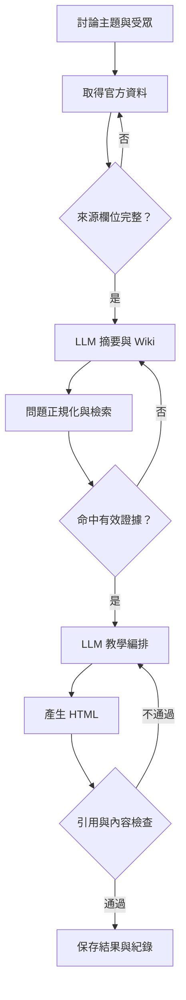

# Loop / graph 設計與實際執行

## 工作流程

問題正規化包括概念標籤及同義詞，例如「筆電」對應「端點」。來源欄位缺漏回資料整理；證據未命中回標籤、條目或來源補充；引用或語意有誤回編排再生成。每項最多修正兩輪，仍不足則停止相關生成並記錄缺口。

## 哪些步驟本次實際重跑？

本次實際迭代發生在檢索：同一份 Wiki、相同六題，先執行 baseline，再執行 improved。圖中其餘回路是操作規則，不代表本次每條回路均觸發。

- 初版：空白切詞，六題皆無結果，第一筆正確數為 0。
- 修正版：標籤與同義詞，六題第一筆皆符合預期，無結果為 0。
- [初版紀錄](runs/baseline.json)／[修正版紀錄](runs/improved.json)

## 角色與檢查界線

LLM 在本次對話中完成來源摘要、整合與教學編排；Python 執行規則檢索、欄位檢查、引用檢查與 HTML 生成。沒有自動 LLM API 呼叫，也沒有自動事實驗證。

最常觀察到的問題是檢索未命中，因此把證據檢查移到編排之前。六題測試不能代表所有問題；原文語意、日期與財報口徑仍需要核對。更多反思見 [reflection.md](reflection.md)。
